# Community Voices

Community Voices writes a weekly **Community Voices Document** for the
[Ruby on Rails forum](https://discuss.rubyonrails.org): what the community discussed in the past week, the themes
that keep coming up, and what it is likely to discuss next. It writes each week's document twice, once with
retrieval-augmented generation (RAG) over that week's posts and once without, and shows both side by side with
metrics, so you can see what retrieval adds.

Everything runs locally and costs nothing: the forum's public JSON API needs no key, and the models run on your
machine with [Ollama](https://ollama.com).

## Quickstart

You need Ruby 3.4 (see `.ruby-version`) and Docker.

```sh
git clone <this repo> community-voices && cd community-voices
docker compose up -d     # Postgres 17 with pgvector on localhost:5432
bin/setup                # gems, databases, seeded demo data, then starts the app
```

Open <http://localhost:3000>. The seeded demo (six weeks of real forum posts with precomputed embeddings, themes
and reports) works right away, **before Ollama is set up**. You only need Ollama to ingest new posts and write new
reports.

Next time, start the app with `bin/dev`. It runs the web server and the background job worker together.

**If port 5432 is taken** by a local Postgres, use another port for both Docker and Rails, and check that nothing
else is listening on it. A local Postgres on the same port answers first, and if it has a `postgres` user, Rails
connects to it without any error.

```sh
export DB_PORT=5434
lsof -nP -iTCP:5434 -sTCP:LISTEN   # should show only Docker once it is up
docker compose up -d && bin/setup
```

## Ollama setup

The app uses two models: `nomic-embed-text` for embeddings and `llama3.2` for writing.

**Native (recommended on a Mac).** Ollama uses the Apple GPU, which is several times faster than Docker.

```sh
brew install ollama            # or download it from https://ollama.com
ollama pull nomic-embed-text   # about 275 MB
ollama pull llama3.2           # about 2 GB
OLLAMA_CONTEXT_LENGTH=8192 ollama serve
```

If you use the Ollama desktop app instead of `ollama serve`, run `launchctl setenv OLLAMA_CONTEXT_LENGTH 8192` and
restart the app.

**Docker (optional, CPU only on a Mac, slower).**

```sh
docker compose --profile ollama up -d   # starts Ollama and pulls both models into a volume
```

Plain `docker compose up -d` still starts only Postgres. If a native Ollama is already using port 11434, set
`OLLAMA_PORT=11435` and `OLLAMA_BASE_URL=http://localhost:11435/v1`.

**Why the context length matters.** The RAG prompt is about 3,600 tokens, and the answer adds about 800 more.
Depending on its version and your memory, Ollama's default context can be as small as 4,096 tokens, and Ollama
**silently cuts off** what does not fit instead of reporting an error, so the model would write from part of the
sources. Both setups above use 8,192 tokens.

Check everything with `bin/rails status` or the **Status** page. Any missing piece shows the exact command that
fixes it.

| Setting | Default |
| --- | --- |
| `OLLAMA_BASE_URL` | `http://localhost:11434/v1` |
| `OLLAMA_EMBEDDING_MODEL` | `nomic-embed-text` (must produce 768-dimension vectors) |
| `OLLAMA_CHAT_MODEL` | `llama3.2` |
| `RAG_RETRIEVER` | `themes` (or `facets`) |
| `THEME_LABELER` | `llm` (or `tfidf`) |
| `REPORT_GENERATION_TIMEOUT_MINUTES` | `10` |

## Demo walkthrough

1. **Status** (`/status`). Postgres, pgvector, Ollama and both models, record counts, the latest week ingested,
   and when the weekly pipeline runs next. Start here before a demo.
2. **Weeks** (`/`). Every week with posts, and the state of its two reports.
3. **Comparison for Nov 16 – 22** (`/reports/compare?week_of=2026-11-16`). The headline line ("7 distinct forum
   posts cited with RAG, 0 without"), the metrics table, and both documents side by side. Citations such as `[3]`
   link to the forum post they came from. Open **Retrieved context** at the bottom to see the 12 chunks the RAG
   version was given, each with the theme that found it and its distance.
4. **Embedding map** (link at the top of the comparison, or `/embeddings?week_of=2026-11-16`). All 88 chunks of
   the six weeks, colored by theme. Bright points are from the report week, faded ones from earlier weeks, and
   bigger points have been retrieved more often. Hover for the post title, click to open the post. The legend
   shows each theme's trend.
5. **Retrieval stats** (`/retrievals/stats`). The chunks, posts and themes the RAG reports lean on most.
6. **A new week**, with Ollama running: click **Generate reports** on a week, or run the whole weekly pipeline
   with `bin/rails pipeline:weekly`. It also runs by itself every Monday at 06:00 UTC while `bin/dev` is up.

## How it maps to the challenge

**1. Collect what the community is saying.** `Ingest::DiscourseFetcher` pages through the forum's public JSON API
and collects every post in the time window. `Ingest::PostImporter` upserts them, so reruns never duplicate.
Rake: `ingest:discourse[days]`. The rest of the app only sees the `Ingest::Fetcher` interface, so another source
plugs in without touching it.

**2. Summarize the past week.** Each document has a Summary, Top discussions and Recurring themes, written by
`Reports::RagGenerator` from the shared prompt `app/prompts/community_voices.md.erb`. Page: the comparison.
Rake: `reports:generate[week_of]`.

**3. Predict what comes next.** Posts are grouped into themes (`Themes::Clusterer`, `Themes::LlmLabeler`), and
`Themes::TrendAnalyzer` marks each theme as new, rising, steady or fading. The RAG prompt gets that trend table
and must base its Predictions for next week on rising and new themes, citing the evidence. Pages: the embedding
map and its legend. Rake: `themes:build[week_of]`.

**4. Compare with and without RAG.** Both versions come from the same template, with the same instructions and
dates. Only the RAG version gets retrieved excerpts and trends. `Reports::ComparisonMetrics` scores them: distinct
posts cited, valid and invalid citations, real thread titles mentioned, length and time. Page: the comparison.

**5. Handle large amounts of data.** Chunk caps per post, digest-based skipping, batched embedding, capped
retrieval and a time-windowed vector index keep work proportional to new content. See
[Decisions and tradeoffs](#decisions-and-tradeoffs).

## Architecture

```mermaid
flowchart LR
  D[Discourse forum<br/>public JSON API] --> F[Ingest::DiscourseFetcher]
  F --> P[(posts)]
  P --> C[Chunking::PostChunker<br/>+ ChunkSyncer]
  C --> CH[(chunks)]
  CH --> E[Embeddings::PendingEmbedder<br/>nomic-embed-text]
  E --> V[(pgvector<br/>HNSW index)]
  V --> T[Themes::Builder<br/>k-means, labels, PCA]
  T --> R[Retrievers<br/>themes or facets]
  V --> R
  R --> PR[Prompt template<br/>excerpts + trends]
  PR --> O[Ollama<br/>llama3.2]
  O --> RP[(reports +<br/>retrievals)]
  RP --> UI[Comparison, map, stats]
```



Posts are split into chunks of up to 1,500 characters, each starting with its post's title, and embedded with
`nomic-embed-text` into a pgvector column with an HNSW index. Each week, the chunks of the six weeks up to it are
clustered into themes, and each theme gets a trend. The theme retriever gives the prompt the chunks closest to each
active theme's center, most momentum first, capped at 16. The chat model writes both versions of the document, and
each retrieved chunk is saved with a snapshot, so a report stays explainable after its posts change.
`WeeklyPipelineJob` runs all of it every Monday through Solid Queue.

## A/B findings

From the seeded reports (`llama3.2` on a MacBook, default settings):

| Week | Retriever | Distinct posts cited (RAG / baseline) | Citations to nonexistent sources | Real thread titles mentioned |
| --- | --- | --- | --- | --- |
| Nov 16 – 22 | themes | 7 / 0 | 0 / 0 | 4 of 8 / 0 of 8 |
| Nov 9 – 15 | themes | 8 / 0 | 1 / 0 | 5 of 9 / 0 of 9 |
| Oct 12 – 18 | facets (Milestone 3) | 0 / 0 | 0 / 0 | 3 of 5 / 0 of 5 |

Observations:

- Without retrieval, the model does not know the week happened. Every baseline describes a plausible but generic
  forum ("best practices for testing and debugging") and invents news: an "upcoming Rails 7.2 release" and a
  "new `concurrent` feature" in Rails 7.0, while the forum was discussing Rails 8.1. None of the three baselines
  mentions a single real thread title.
- With retrieval, the documents name the real threads of the week, and with the theme retriever they cite 7 to 8
  different posts. Their predictions follow the themes the trend table marks as new or rising.
- The baselines never cite anything, so the "citations to nonexistent sources" check rarely fires. The one invalid
  citation came from the RAG side.
- `llama3.2` (3B parameters) follows citation rules unreliably. It sometimes stacks many citations on one
  sentence, which is why each run of citations counts for at most three sources, and the October report ignored
  the rule entirely and cited nothing, although it does name real threads.
- Retrieval reduces invention but does not remove it: the October RAG report calls Ractor "a new concurrency
  feature in Rails", though Ractor is part of Ruby.
- RAG takes about 1.5 times as long, almost all of it reading the longer prompt. Retrieval itself takes under a
  second.

<!-- YOUR NOTES: add your own observations from the demo here. -->
**My notes:** _(to be added)_

## Decisions and tradeoffs

**Local Ollama.** It means zero cost and no credentials for a reviewer to set up. The price is quality and
speed: a 3B model on a laptop is slow and imprecise next to a hosted model. Every model call goes through
`ruby_llm`, so switching to a hosted provider is a configuration change, not a rewrite.

**Discourse instead of Reddit.** Reddit's API requires approval for new apps, and its unauthenticated JSON
endpoints were shut down in 2026. The Rails forum's Discourse API is public, stable and polite to use: the client
identifies itself and pauses between requests.

**Handling large amounts of data.**
- Filters: posts shorter than 20 characters ("Thanks!", "+1") are not chunked, and hidden (community-flagged) and
  non-regular posts, such as moderator actions, are skipped. Discourse has no Reddit-style vote scores to filter on.
- Chunk cap: one post contributes at most 8 chunks, so a huge thread cannot crowd out the rest.
- Digest-based skipping: a chunk whose SHA256 digest is unchanged keeps its embedding, so a rerun embeds only new
  or edited text, and re-syncing unchanged posts writes nothing.
- Batching: embeddings go to Ollama 32 at a time.
- Retrieval caps: at most 4 chunks per theme or facet and 16 in total, so the prompt fits the context window
  however much was posted.
- Vector search uses an HNSW index with pgvector's iterative scan, so time-filtered searches stay fast and still
  return enough results as the archive grows.

**Theme retrieval over fixed facets.** Milestone 3 searched six hand-written facet queries ("deployment and
infrastructure", ...). The theme retriever, now the default, lets the data define the topics and brings the trend
table that predictions need. The facet retriever is still there (`RAG_RETRIEVER=facets`) for comparison.

**Weak clusters.** k is chosen by the best silhouette score for k from 3 to 8, and forum text scores around 0.1,
which means the themes overlap. They are useful groupings, not sharp categories. A single large catch-all theme is
common.

## Limitations and future work

- **More sources.** A Reddit fetcher, through a headless browser or an approved API app, would plug in through the
  existing `Ingest::Fetcher` interface.
- **A hosted model option.** A larger model would write better and follow citation rules more reliably; with
  `ruby_llm` this is mostly configuration.
- **Better theme labels.** The LLM labeler reads only the five most central chunks of each theme, and the 3B model
  occasionally picks a narrow name for a broad theme.
- **Ctrl-C noise.** Stopping `bin/dev` prints a `ThreadError ... can't be called from trap context` trace after
  Solid Queue has already shut down cleanly. It comes from Rails' logging during Puma's shutdown and does not
  affect jobs.

## Running the tests

```sh
bundle exec rspec
bin/rubocop
```

No test touches the network or Ollama. HTTP is stubbed with WebMock against real forum responses saved in
`spec/fixtures/discourse/`. Embeddings come from `Embeddings::FakeClient`, which derives a deterministic vector
from each text, and writing comes from `Llm::FakeChatClient`. Clustering is tested on synthetic vectors with
known groups, and similarity search runs against real pgvector.

## Reference

### Rake tasks

| Task | What it does |
| --- | --- |
| `pipeline:weekly[force]` | The weekly run for the last complete week: ingest, chunk, embed, themes, reports. Skips themes and reports that already exist unless `force` |
| `pipeline:refresh[days]` | Ingest the last N days, then chunk and embed |
| `ingest:discourse[days]` | Fetch posts from the last N days (default 7) |
| `chunks:sync` / `embed:pending` | Chunk new and edited posts / embed chunks that have no embedding |
| `themes:build[week_of]` | Cluster, label and project the six weeks ending with a week, and print the themes |
| `reports:generate[week_of]` | Write both reports for a week and print the metrics |
| `search:similar["query"]` | Print the five chunks closest to a query |
| `seeds:export` | Write the last six weeks of data to `db/seeds/community_voices.json.gz` |
| `status` | Check the services and print fixes |

### Code map

| Area | Main classes |
| --- | --- |
| Ingestion | `Ingest::DiscourseClient`, `DiscourseFetcher`, `DiscoursePostMapper`, `HtmlToText`, `PostImporter`, `Pipeline` |
| Chunks and search | `Chunking::TextSplitter`, `PostChunker`, `ChunkSyncer`; `Embeddings::OllamaClient`, `PendingEmbedder`; `Search::SimilarChunks` |
| Themes | `Themes::KMeansSelector`, `Clusterer`, `LlmLabeler` (falls back to `Labeler`), `Projector`, `TrendAnalyzer`, `Builder` |
| Reports | `Reports::ThemeContextRetriever`, `ContextRetriever`, `PromptBuilder`, `RagGenerator`, `BaselineGenerator`, `ComparisonMetrics` |
| Automation | `WeeklyPipelineJob` and the `WeeklyPipeline::*Step` classes; `config/recurring.yml` |
| Pages | `Reports::Comparison`, `Reports::MarkdownRenderer`, `Themes::EmbeddingMapSerializer`, `RetrievalStatsQuery`, `Status::Overview` |
| Seed data | `Seeds::Exporter`, `Seeds::Importer` |

Interfaces with two implementations each pick theirs in one place: `Embeddings.client`, `Llm.client`,
`Themes.labeler` and `Reports::Retriever.configured`. Tests always get the fake or offline one.
